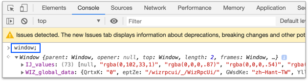
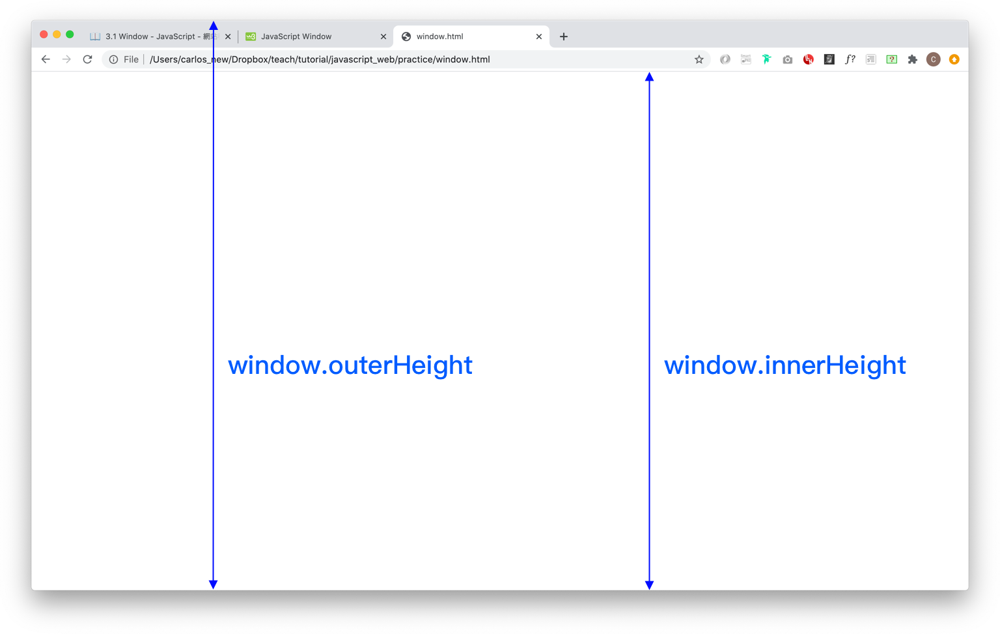

# 3.1 window

## 認識 window 物件

打開 Google 頁面(或任何網站都可)，在 console 中，輸入 window 物件。如下圖：



有龐大的函式、物件等可以使用。例如簡單常用的：

```javascript
alert("popup 訊息");
```

完整的寫法，是：

```javascript
window.alert("popup 訊息");
```


## window 視窗寬高

* window.innerWidth
* window.outerWidth
* window.innerHeight
* window.outerHeight

下圖以高度(Height)為例(寬度同理)：



