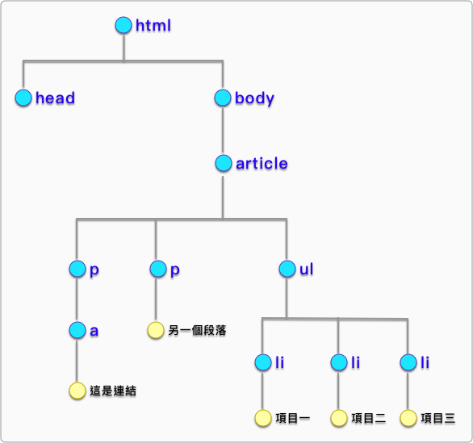

# 4.1 DOM 簡介

DOM = Document Object Model，中文即「文件物件模型」。

## DOM tree

建立 `practice/dom.html` 檔案，內容如下：

```html
<!doctype html>
<html>
  <head>
  </head>
  <body>
    <article>
      <p><a href="#">這是連結</a></p>
      <p>另一個段落</p>
      <ul>
        <li>項目一</li>
        <li>項目二</li>
        <li>項目三</li>
      </ul>
    </article>
  </body>
</html>
```

瀏覽器解析以上 html 後，產出的 DOM tree：



### 解析錯誤？

```markup
<p>這是段落<div>這是 div 區塊</div></p>
```


## DOM Scripting 簡介

javascript 本身並沒有 window、document 這種物件，這是瀏覽器解析完之後，提供給開發人員使用的，例如：

`window.alert()`

`document.getElementById()`

`document.setAttribute()`

`document.getAttribute()`

以上這些其實都是 **DOM Scripting**，[參考書籍](https://domscripting.com/book/)。

