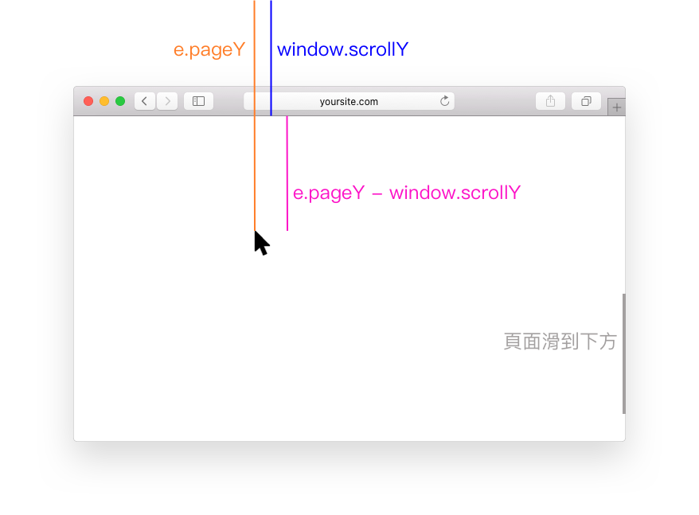

# 5.7 滑鼠相關事件

## click 與事件冒泡狀況(Event Bubble Up)

```javascript
var my_el = document.getElementById("my_el");
my_el.addEventListener("click", function(e){
  // 點擊後，要執行的程式...
  e.stopPropagation();
});
```


範例(click)：[https://codepen.io/editor/carlos411/pen/01a1cd91-0b1c-7145-a900-1ce1542bc1a0](https://codepen.io/editor/carlos411/pen/01a1cd91-0b1c-7145-a900-1ce1542bc1a0)



如果要停止事件冒泡狀況發生，在某個位置執行以下程式：

```javascript
e.stopPropagation();
```


### 範例：lightbox (燈箱)

例：[https://codepen.io/editor/carlos411/pen/01a1cd95-4bc6-7db4-ae6b-ae1da5da9023](https://codepen.io/editor/carlos411/pen/01a1cd95-4bc6-7db4-ae6b-ae1da5da9023)




## 其它滑鼠相關事件


### dblclick

`dblclick`：滑鼠左鍵快速點兩下時觸發。

例：[https://codepen.io/editor/carlos411/pen/01a1cd97-cf70-7dee-aa9a-c2df411fdd67](https://codepen.io/editor/carlos411/pen/01a1cd97-cf70-7dee-aa9a-c2df411fdd67)




### mousedown、mouseup

`mousedown`：滑鼠左鍵按壓下去時觸發。(會觸發事件冒泡狀況)

`mouseup`：滑鼠左鍵按壓下去放開時觸發。(會觸發事件冒泡狀況)

例：[https://codepen.io/editor/carlos411/pen/01a1ce7c-9691-76ab-9fed-f85c114a287a](https://codepen.io/editor/carlos411/pen/01a1ce7c-9691-76ab-9fed-f85c114a287a)




### mouseover、mouseout

`mouseover`：滑鼠移入時觸發。(會觸發事件冒泡狀況)

`mouseout`：滑鼠移出時觸發。(會觸發事件冒泡狀況)

例：[https://codepen.io/editor/carlos411/pen/01a1ce7f-e527-79ca-803f-c916dc98511a](https://codepen.io/editor/carlos411/pen/01a1ce7f-e527-79ca-803f-c916dc98511a)




### mouseenter、mouseleave

`mouseenter`：滑鼠移入時觸發。(不會觸發事件冒泡狀況)

`mouseleave`：滑鼠移出時觸發。(不會觸發事件冒泡狀況)

例：[https://codepen.io/editor/carlos411/pen/01a1ce82-f2ef-77cc-b396-3d4ae0a749c8](https://codepen.io/editor/carlos411/pen/01a1ce82-f2ef-77cc-b396-3d4ae0a749c8)




### mousemove

`mousemove`：滑鼠游標在元素上移動時觸發。(會觸發事件冒泡狀況)

例：[https://codepen.io/editor/carlos411/pen/01a1ce85-ccdc-7ab1-9846-9b7ca77f4c60](https://codepen.io/editor/carlos411/pen/01a1ce85-ccdc-7ab1-9846-9b7ca77f4c60)




### 範例：圖片跟著滑鼠移動

針對 document 綁定 mousemove 事件。

`e.pageX`：滑鼠距離頁面最左側的距離。

`e.pageY`：滑鼠距離頁面最上方的距離。

`window.scrollY`：垂直方向滑動了多少距離。

示意圖：



簡介 position: fixed 這個 css。

例：[https://codepen.io/editor/carlos411/pen/01a1ce90-62ec-7a05-95d9-49d9c60c1674](https://codepen.io/editor/carlos411/pen/01a1ce90-62ec-7a05-95d9-49d9c60c1674)







參考作法：



