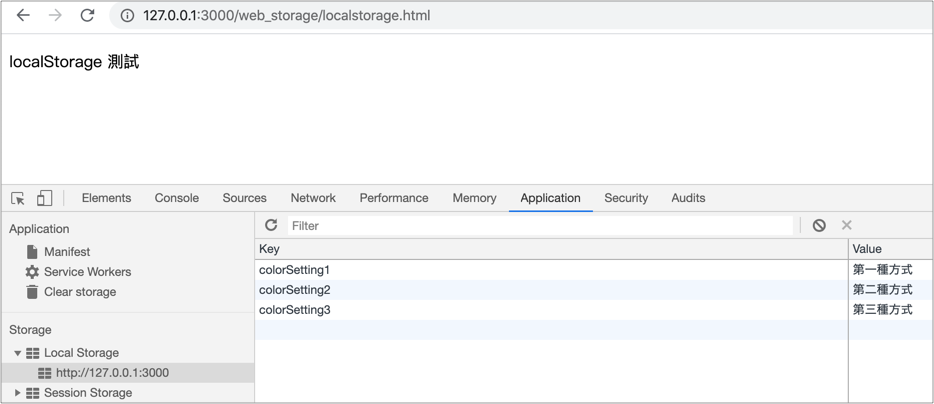

# 7.1 localStorage

在 `practice` 資料夾下，建立 `localstorage.html` ，以便練習。


## localStorage 儲存

以下是將資料儲存在 localStorage 的三種寫法，以 `key-value` 的方式儲存，例：

```javascript
localStorage.colorSetting1 = '第一種方式';
localStorage['colorSetting2'] = '第二種方式';
localStorage.setItem('colorSetting3', '第三種方式');
```

開啟本機端網址來觀察，如下圖：




儲存 JSON 格式資料，使用 **`JSON.stringify()`**&#x5C07;資料字串化：

```javascript
localStorage.setItem("car", JSON.stringify({doors: 4, brand_name: "toyota"}));
```


## localStorage 資料擷取

可透過以下方式取得 localStorage 裡的資料：

```javascript
var get_color = localStorage.colorSetting2;
// 或
var get_color = localStorage.getItem("colorSetting2");
// 或
var get_color = localStorage['colorSetting2'];
```

如果 localStorage 裡沒有指定的資料，會回傳 `undefined`。

如果有儲存 JSON 資料，取出時，通常會用 `JSON.parse()` 來轉回物件格式：

```javascript
var car = JSON.parse(localStorage.getItem("car"));
console.log(car);
```


## localStorage 資料更新

可透過以下方式來更新 localStorage 裡的資料：

```javascript
localStorage.colorSetting2 = "red";
// 或
localStorage.setItem("colorSetting2", "red");
// 或
localStorage['colorSetting2'] = "red";
```


## localStorage 資料刪除

可透過以下方式來刪除 localStorage 裡的資料：

```javascript
// 刪除單一項目
localStorage.removeItem("colorSetting2");

// 清空
localStorage.clear();
```

